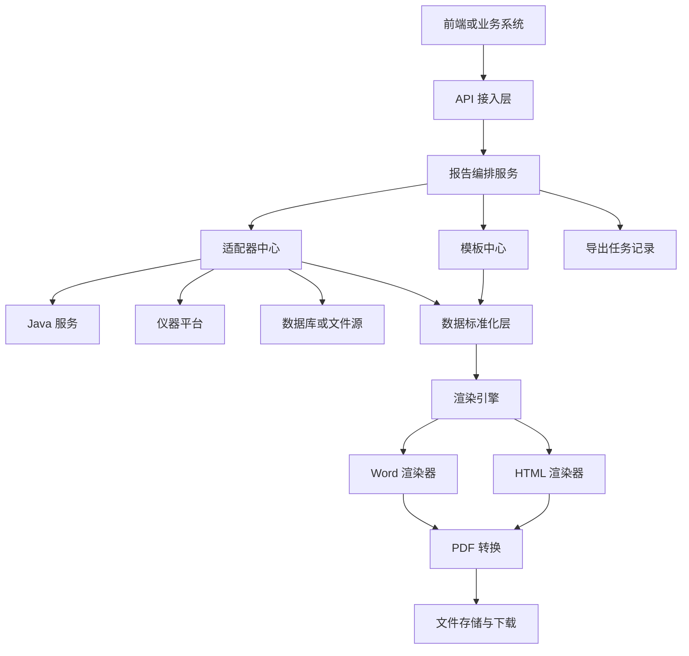
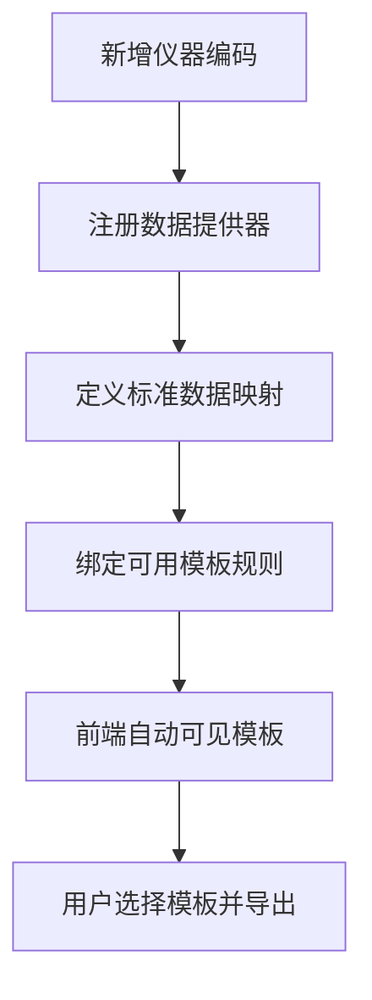

# 报告模块标准化设计愿景与实施方案

## 1. 文档目的

本文档用于描述报告模块未来的标准化建设方向，目标不是讨论当前代码是否容易改造，而是给出后续大改版时应采用的统一设计方案、落地方式和实施路径，为后续架构升级、项目复制和多仪器接入提供统一依据。

本方案重点解决以下问题：

1. 新增仪器时，如何尽量少改主流程代码。
2. 新增模板时，如何通过配置和规则完成接入，而不是项目式硬编码。
3. 多个仪器、多个模板、多个项目并行时，如何保持低耦合和可维护性。
4. 报告生成过程如何从“按项目开发”升级为“按平台能力扩展”。

## 2. 目标愿景

未来的报告平台，不再以“某个模板”或“某个仪器”作为系统中心，而是以“报告能力平台”作为中心。平台负责四件事：

1. 根据前端传入的业务条件，返回可选模板列表。
2. 根据用户最终选择的模板，自动匹配对应的数据适配器。
3. 将不同仪器、不同接口返回的数据，统一转换为标准报告数据模型。
4. 使用统一渲染引擎输出 PDF，并支持版本化、扩展和回滚。

一句话总结：

**前端只表达业务意图，平台负责模板发现、数据适配、标准化转换和报告渲染。**

## 3. 标准化建设原则

### 3.1 前端只传业务标识，不传实现细节

前端不应直接绑定底层模板实现，也不应感知具体接口地址。前端只负责传递业务参数，例如：

- 仪器型号 `instrument_code`
- 模板类型 `template_type`
- 任务编号 `task_id`
- 样品编号 `sample_id`
- 分析编号 `analysis_id`
- 项目标识 `tenant_id` 或 `project_code`

### 3.2 模板选择与数据获取分离

模板负责“如何展示”，数据适配器负责“如何获取数据”，标准化层负责“如何把异构数据变成统一数据结构”。三者不能混在一起。

### 3.3 模板与仪器不是强绑定的一对一关系

未来实际业务中会出现以下情况：

1. 一个仪器支持多种报告类型。
2. 一个模板可适配多个仪器。
3. 同一仪器在不同客户项目中可能使用不同模板版本。
4. 同一模板在不同阶段可能升级多个版本。

因此，模板和仪器应通过“绑定规则”关联，而不是直接一对一写死。

### 3.4 优先共享元数据中心，不按项目随意拆库

原则上不建议每来一个项目就单独建立一套报告元数据库。标准做法应是：

1. 建立统一的“报告元数据中心库”。
2. 业务数据仍保留在现有业务系统、Java 服务或设备平台侧。
3. 通过租户、项目编码、权限和部署方式实现逻辑隔离。
4. 只有在强隔离、独立部署、合规要求明确时，才考虑单独建库。

### 3.5 版本化优先于覆盖式修改

模板、字段映射、适配规则都应支持版本管理。任何重大修改，都应以新增版本的方式发布，而不是直接覆盖线上配置。

## 4. 推荐的业务交互模式

基于未来标准化设计，推荐的前后端交互流程如下。

### 4.1 第一步：模板发现

前端先传入：

- `instrument_code`
- `template_type`
- 可选的 `report_scene`
- 可选的 `project_code`

平台根据这些条件查询模板目录，返回当前可用模板列表。

此时返回的不是文件内容，而是可供选择的模板清单，包括：

- 模板 ID
- 模板名称
- 模板类型
- 适用仪器
- 当前版本
- 是否默认模板
- 描述信息

### 4.2 第二步：用户选择模板

用户在前端页面上看到符合该仪器型号和模板类型的模板列表，手动选择最终模板。

### 4.3 第三步：提交导出任务

前端提交：

- `task_id`
- `template_id`
- `sample_id`
- `analysis_id`
- 可选导出参数

后端根据模板 ID 获取模板版本，再根据该模板绑定的规则找到对应的数据适配器，然后向 Java 服务或设备平台请求数据，转换为统一上下文，最后生成 PDF。

这套交互方式有一个明显优势：

**模板选择权交给业务用户，模板实现权交给平台，模板适配逻辑不暴露给前端。**

## 5. 目标业务流程图


## 6. 目标架构设计

未来报告平台建议划分为六层。

### 6.1 接入层

负责接收前端请求，包括：

- 模板查询接口
- 报告导出接口
- 导出任务状态接口

这一层只负责协议接入、参数校验、权限校验和响应封装，不承担业务编排和渲染实现。

### 6.2 报告编排层

这是平台核心控制层，负责：

- 解析导出请求
- 选择模板版本
- 查找适配器
- 组织数据流转
- 调度渲染引擎
- 记录导出任务

这一层是未来平台的“大脑”，但不直接耦合某个仪器、某个模板或某个 Java 接口。

### 6.3 模板中心

模板中心负责模板管理和版本管理，包括：

- 模板基础信息
- 模板版本
- 模板字段定义
- 模板适用范围
- 模板绑定规则
- 模板启停与灰度

模板中心不关心底层接口地址，只关心模板本身的业务元数据。

### 6.4 适配器中心

适配器中心负责对接外部数据来源，包括：

- Java HTTP 接口
- 仪器平台接口
- 数据库直连
- 文件或缓存数据源

适配器中心的责任是把异构外部数据取回来，不直接参与模板渲染。

### 6.5 数据标准化层

该层负责把外部原始数据映射为统一的 `ReportContext`，解决不同仪器、不同项目、不同接口返回结构不一致的问题。

这是标准化体系里最重要的一层。没有这层，模板就会被迫直接适配每一种外部 JSON，最终导致模板和接口强耦合。

### 6.6 渲染输出层

渲染输出层只负责把标准上下文渲染为报告文件。建议抽象为统一引擎接口，支持：

- Word 模板渲染 `docxtpl`
- HTML 模板渲染 `Playwright`
- 未来扩展 Excel、图片报告、电子签章等

## 7. 目标架构图



## 8. 核心实现方式

### 8.1 模板目录服务

模板目录服务负责回答一个问题：

**当前这个仪器型号、模板类型、项目场景下，前端应该看到哪些模板。**

建议接口示例：

#### 查询模板列表

```json
POST /report/templates/query
{
  "instrument_code": "T800",
  "template_type": "original_record",
  "project_code": "default",
  "report_scene": "measure_report"
}
```

返回示例：

```json
{
  "code": 200,
  "data": [
    {
      "template_id": 1001,
      "template_code": "t800_original_default",
      "template_name": "T800 原始记录默认模板",
      "template_type": "original_record",
      "render_engine": "docxtpl",
      "version": "v3",
      "is_default": true
    },
    {
      "template_id": 1002,
      "template_code": "t800_original_customer_a",
      "template_name": "T800 原始记录客户A模板",
      "template_type": "original_record",
      "render_engine": "docxtpl",
      "version": "v2",
      "is_default": false
    }
  ]
}
```

### 8.2 导出编排服务

导出编排服务负责回答另一个问题：

**用户已经选定模板后，平台如何稳定地生成报告。**

建议接口示例：

```json
POST /report/export
{
  "task_id": "task_001",
  "template_id": 1001,
  "sample_id": "sample_001",
  "analysis_id": "analysis_001"
}
```

平台内部处理步骤为：

1. 根据 `template_id` 找到模板主信息与当前发布版本。
2. 根据模板绑定规则找到对应的数据提供器。
3. 调用适配器从 Java 或其他系统获取数据。
4. 将原始数据映射为统一 `ReportContext`。
5. 调用对应渲染引擎生成中间文件。
6. 转换为 PDF 并返回下载链接或文件流。
7. 记录导出任务、耗时、状态和错误日志。

### 8.3 数据提供器机制

未来不建议把“接口 URL”直接写到模板表中，而是引入“数据提供器”概念。

数据提供器的抽象职责如下：

1. 识别数据来源类型。
2. 根据配置调用对应服务。
3. 返回统一的原始数据对象。
4. 对超时、认证失败、数据缺失进行统一处理。

例如，可以有以下提供器类型：

- `java_http_provider`
- `instrument_platform_provider`
- `database_provider`
- `mock_provider`

模板只绑定提供器编码，不直接绑定接口地址。这样后续接口地址调整、服务迁移、认证方式变更时，模板不用跟着改。

### 8.4 标准数据模型 ReportContext

建议定义一个统一的报告上下文对象 `ReportContext`，所有模板只消费这个对象。

推荐结构如下：

```json
{
  "task": {},
  "instrument": {},
  "sample": {},
  "analysis": {},
  "result": {},
  "tables": [],
  "curves": [],
  "images": [],
  "meta": {}
}
```

其中：

- `task` 存放任务信息
- `instrument` 存放仪器信息
- `sample` 存放样品信息
- `analysis` 存放分析过程信息
- `result` 存放最终结果与结论
- `tables` 存放动态表格
- `curves` 存放曲线、谱图等图形数据
- `images` 存放签字图、二维码等图片资源
- `meta` 存放页眉、页脚、版本号、导出时间等公共信息

这一层统一后，模板开发和仪器接入就能真正分离。

### 8.5 渲染引擎抽象

建议抽象统一渲染接口：

```text
render(template_version, report_context) -> file
```

然后按引擎类型落到不同实现：

1. WordRenderer
2. HtmlRenderer
3. PdfPostProcessor

这样模板系统将来可以同时支持多种渲染方式，而不是在一个工具类里混杂所有逻辑。

### 8.6 模板规则引擎

建议把“模板适用条件”从代码里抽出，放到规则表或配置中，例如：

- 仪器型号
- 模板类型
- 报告场景
- 测量模式
- 项目编码
- 是否默认
- 优先级
- 生效时间
- 失效时间

平台根据这些条件动态决定“应该展示哪些模板”和“默认选中哪个模板”。

## 9. 数据库设计建议

### 9.1 是否每个项目都需要单独建库

不建议默认每个项目单独建库。

推荐模式是：

1. 报告平台使用统一元数据中心库。
2. 通过 `tenant_id`、`project_code`、权限隔离和规则隔离支持多项目共存。
3. 业务原始数据仍由 Java 服务或业务数据库提供。
4. 仅在客户要求私有部署或数据物理隔离时，再将元数据中心独立部署。

这样可以避免：

1. 模板重复维护。
2. 字段定义重复建设。
3. 新功能需要多库同步升级。
4. 运维复杂度指数级提升。

### 9.2 推荐核心表

#### 1. 仪器定义表 instrument

| 字段            | 说明              |
| --------------- | ----------------- |
| id              | 主键              |
| instrument_code | 仪器编码，如 T800 |
| instrument_name | 仪器名称          |
| instrument_type | 仪器类别          |
| vendor          | 厂商              |
| status          | 状态              |

#### 2. 数据提供器表 data_provider

| 字段            | 说明               |
| --------------- | ------------------ |
| id              | 主键               |
| provider_code   | 提供器编码         |
| provider_name   | 提供器名称         |
| provider_type   | 类型，如 java_http |
| endpoint_config | 接口配置 JSON      |
| auth_config     | 认证配置 JSON      |
| timeout_seconds | 超时时间           |
| status          | 状态               |

#### 3. 仪器与提供器绑定表 instrument_provider_binding

| 字段            | 说明       |
| --------------- | ---------- |
| id              | 主键       |
| instrument_code | 仪器编码   |
| provider_code   | 提供器编码 |
| scene           | 场景       |
| priority        | 优先级     |
| status          | 状态       |

#### 4. 模板主表 report_template

| 字段          | 说明     |
| ------------- | -------- |
| id            | 主键     |
| template_code | 模板编码 |
| template_name | 模板名称 |
| template_type | 模板类型 |
| render_engine | 渲染引擎 |
| report_scene  | 报告场景 |
| description   | 描述     |
| status        | 状态     |

#### 5. 模板版本表 report_template_version

| 字段             | 说明         |
| ---------------- | ------------ |
| id               | 主键         |
| template_code    | 模板编码     |
| version          | 版本号       |
| template_content | 模板内容     |
| mapping_config   | 字段映射配置 |
| schema_version   | 数据契约版本 |
| is_active        | 是否生效     |
| created_by       | 创建人       |
| created_at       | 创建时间     |

#### 6. 模板绑定规则表 template_binding_rule

| 字段            | 说明     |
| --------------- | -------- |
| id              | 主键     |
| instrument_code | 仪器编码 |
| template_type   | 模板类型 |
| project_code    | 项目编码 |
| report_scene    | 报告场景 |
| template_code   | 模板编码 |
| target_version  | 目标版本 |
| is_default      | 是否默认 |
| priority        | 优先级   |
| status          | 状态     |

#### 7. 导出任务表 export_job

| 字段             | 说明       |
| ---------------- | ---------- |
| id               | 主键       |
| job_no           | 导出任务号 |
| task_id          | 业务任务号 |
| template_id      | 模板 ID    |
| template_version | 模板版本   |
| instrument_code  | 仪器编码   |
| status           | 导出状态   |
| error_message    | 错误信息   |
| output_path      | 输出地址   |
| duration_ms      | 耗时       |
| created_at       | 创建时间   |

## 10. 为什么这套设计更适合未来大改版

### 10.1 对前端更稳定

前端只需要知道：

1. 先按仪器型号和模板类型拉模板列表。
2. 用户选模板。
3. 再提交模板 ID 和 task_id。

这非常符合你现在想表达的业务流程，而且不会把底层实现细节暴露给前端。

### 10.2 对后端更低耦合

新增一个仪器时，后端理论上只需要处理三件事：

1. 增加或复用数据提供器。
2. 配置仪器与提供器绑定关系。
3. 配置该仪器可见的模板规则。

主流程代码不需要因为每个新仪器而频繁修改。

### 10.3 对模板管理更友好

模板不再只是一个文件，而是一个带版本、带规则、带适用范围的受控资产。

### 10.4 对项目复制更高效

以后新增项目时，不需要从头复制一套代码和数据库结构，只需要：

1. 配置项目规则。
2. 选择已有模板版本。
3. 必要时新增项目专属模板版本。

## 11. 新增一个仪器时的标准实施方式

未来建议把“新增仪器”的工作拆成标准四步。



具体说明如下：

### 第一步：注册仪器

在 `instrument` 表中新增仪器定义，例如 T800。

### 第二步：配置数据提供器

配置该仪器对应的数据来源，比如 Java 服务地址、认证方式、超时策略和接口路径。

### 第三步：定义标准化映射

将该仪器返回的字段映射到统一 `ReportContext`，例如：

- 仪器返回 `deviceName` 映射到 `instrument.name`
- 仪器返回 `workSheets` 映射到 `tables`
- 仪器返回 `curveData` 映射到 `curves`

### 第四步：绑定模板规则

定义这个仪器在什么场景、什么项目下可以看到哪些模板，哪个模板为默认模板。

### 第五步：前端自动生效

前端继续沿用同一套模板查询接口，不需要额外开发新的前端逻辑。

## 12. 模板字段扩展策略

未来模板加字段时，建议分成三类处理。

### 12.1 公共字段

例如：

- 仪器名称
- 样品名称
- 检测时间
- 结论

这些字段应进入标准 `ReportContext`，所有模板通用复用。

### 12.2 模板专属字段

例如某个客户专属页脚、某种专属统计列、特殊图片块。

这些字段应通过模板版本的 `mapping_config` 或字段定义表管理，而不是直接改数据库主表结构。

### 12.3 扩展字段

对于还不稳定、仍在试验阶段的字段，可放入 `ext` 或 `meta.ext` 中，避免频繁改动主数据结构。

这样可以避免模板每加一个字段，数据库就做一次结构性变更。

## 13. 平台治理建议

如果未来要真正标准化，仅有架构还不够，还需要平台治理机制。

### 13.1 模板治理

1. 模板编码统一命名规范。
2. 模板版本必须可追溯。
3. 模板发布必须支持回滚。
4. 模板启停需要审核机制。

### 13.2 数据契约治理

1. 所有适配器必须遵守统一 `ReportContext` 契约。
2. 契约变更需要版本号。
3. 新增字段必须说明用途、来源和兼容策略。

### 13.3 运行治理

1. 导出任务必须可追踪。
2. 错误日志必须能定位到模板版本和适配器版本。
3. 要统计每个模板、每个仪器的导出成功率和平均耗时。

## 14. 分阶段实施路线

### 阶段一：目录化

目标：让平台具备“模板可发现”能力。

建设内容：

1. 建立模板主表、模板版本表、绑定规则表。
2. 前端改为先查询模板列表，再提交模板 ID。
3. 把模板管理从单纯文件管理提升到模板目录管理。

### 阶段二：适配器化

目标：让平台具备“数据源可插拔”能力。

建设内容：

1. 建立数据提供器模型。
2. 将不同 Java 接口封装为适配器。
3. 建立统一错误处理和超时策略。

### 阶段三：标准上下文化

目标：让模板彻底摆脱外部接口差异。

建设内容：

1. 设计统一 `ReportContext`。
2. 完成各类仪器到 `ReportContext` 的映射。
3. 将模板渲染逻辑切换到标准上下文驱动。

### 阶段四：引擎化与平台化

目标：让平台具备长期演进能力。

建设内容：

1. 统一渲染引擎接口。
2. 支持灰度发布、审批和回滚。
3. 建立导出任务监控、模板治理和统计分析。

## 15. 对领导可直接汇报的价值总结

本方案的核心价值，不是简单做一次代码重构，而是把报告输出能力建设成平台能力。

预期收益如下：

1. 新增仪器时，从“修改主流程代码”转为“注册适配器加配置规则”。
2. 新增模板时，从“项目式开发”转为“模板资产管理加版本发布”。
3. 新增项目时，从“复制系统”转为“复用平台能力加项目配置”。
4. 平台后续可支持更多渲染方式和更多报告场景，而不需要推翻整体架构。
5. 整体开发模式从人治式维护，升级为规则驱动和资产驱动。

可用于汇报的一句话结论：

**未来报告模块的标准化目标，是把模板选择、数据获取、数据转换和报告渲染彻底分层，最终形成一个可扩展、可复用、可治理的报告平台。**

## 16. 汇报时建议重点强调的三句话

1. 前端负责选择业务条件和最终模板，平台负责完成剩余所有技术细节。
2. 平台不再按项目堆代码，而是通过模板中心、适配器中心和标准上下文实现复用。
3. 新增仪器、新增模板、新增项目，都应尽量通过注册、配置和版本发布完成，而不是改动核心流程。
